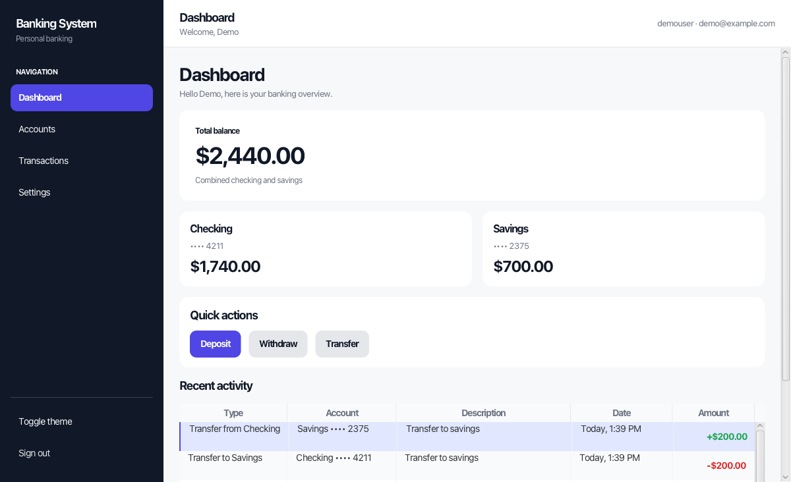
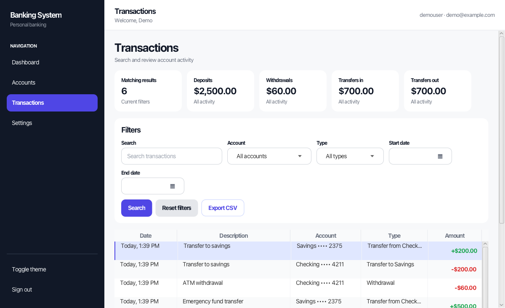
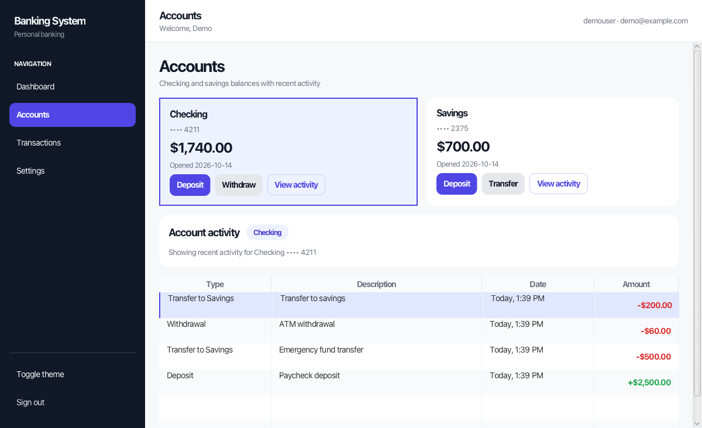
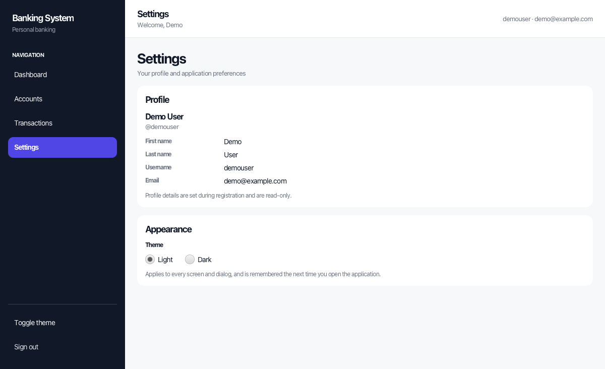
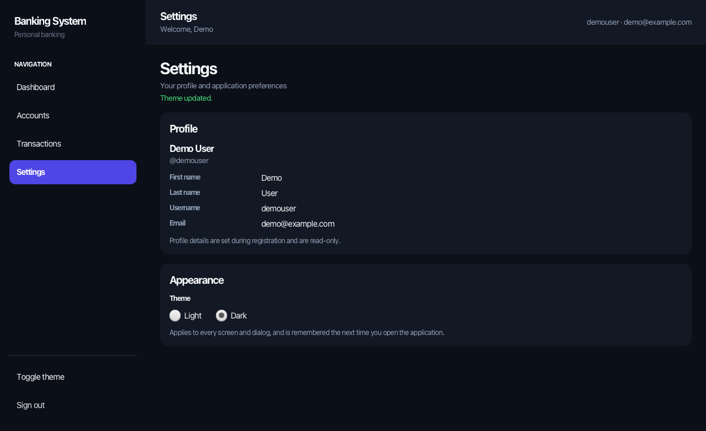
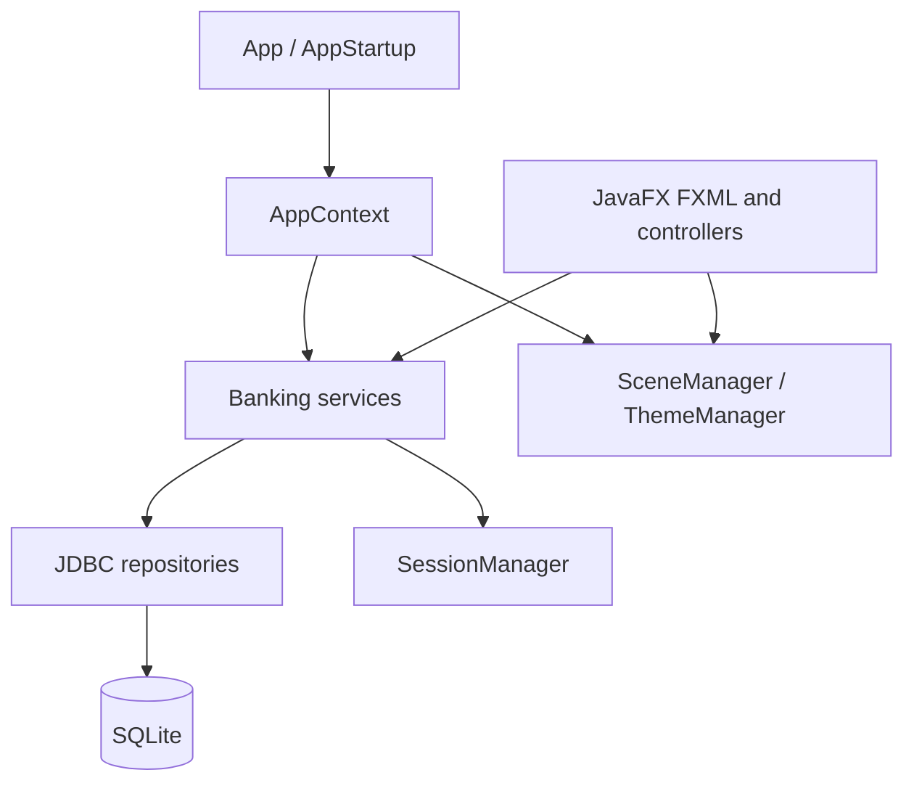

# Java Banking System

[](https://github.com/ManpreetS2/JavaBankingSystem/actions/workflows/ci.yml) [](https://github.com/ManpreetS2/JavaBankingSystem/releases/tag/v1.0.0)  

**A local desktop banking simulation built with Java 21, JavaFX, SQLite, and Maven.**

Sign in, manage checking and savings accounts, make deposits and withdrawals, transfer funds between your own accounts, and review searchable transaction history. Built as a portfolio application to demonstrate correct transaction processing and desktop UI engineering—not a real bank or payment service.

**[📦 Download v1.0.0 for macOS](https://github.com/ManpreetS2/JavaBankingSystem/releases/download/v1.0.0/BankingSystem-v1.0.0-macOS.zip)** · **[▶ Watch the 70-second demo](https://github.com/ManpreetS2/JavaBankingSystem/releases/download/v1.0.0/JavaBankingSystem-demo.mp4)** · [Release notes](https://github.com/ManpreetS2/JavaBankingSystem/releases/tag/v1.0.0) · [Source code](https://github.com/ManpreetS2/JavaBankingSystem)

## See it in action



The [70-second visual walkthrough](docs/demo/JavaBankingSystem-demo.mp4) uses actual JavaFX screenshots, not simulated clicks. Also available: [download the MP4](https://github.com/ManpreetS2/JavaBankingSystem/releases/download/v1.0.0/JavaBankingSystem-demo.mp4) and [read the live-demo walkthrough](docs/DEMO.md).

## Download and run on macOS

1. [Download the v1.0.0 macOS ZIP](https://github.com/ManpreetS2/JavaBankingSystem/releases/download/v1.0.0/BankingSystem-v1.0.0-macOS.zip).
2. Unzip it and open **BankingSystem.app**. You can move the app to **Applications** if you prefer.
3. Create an account to try checking, savings, and internal transfers, or [run the seeded demo from source](#demo-mode).

> **Important:** The downloadable macOS app is **unsigned and not notarized**. macOS may warn or prevent it from opening because Apple has not verified it. Verify the source and decide whether you trust the app before considering any exception; see [Apple's guidance on opening unverified apps](https://support.apple.com/en-ie/102445). No real financial accounts or external payment networks are connected.

The packaged download is a macOS app image, not a Windows or Linux installer. Other platforms can build from source where their JavaFX/JDK tooling is supported.

## Highlights

- Secure registration and sign-in
- Checking and savings accounts
- Deposits, withdrawals, and atomic internal transfers
- Searchable, filterable transactions with pagination and CSV export
- Light and dark themes, remembered between launches
- Downloadable macOS app image and a 70-second demo video
- 197 automated tests

## What this project demonstrates

- Layered Java desktop architecture: JavaFX controllers, services, JDBC repositories, SQLite
- Exact money handling with `BigDecimal` (scale 2), stored as text rather than floating point
- Transfers that update both balances and write both ledger rows in one database transaction
- Account ownership checks so one user cannot read or move another user's funds
- PBKDF2-HMAC-SHA256 password hashing with a unique salt
- Prepared SQL statements
- Filtered, paginated transaction queries and CSV export
- A persisted light/dark theme
- Automated tests around banking rules, schema safety, and presentation
- A `jpackage` app image with an application icon

## Screenshots

| Transactions | Accounts |
| --- | --- |
|  |  |

| Settings | Dark theme |
| --- | --- |
|  |  |

Also captured: [sign-in](docs/screenshots/01-login.png) and the [transfer dialog](docs/screenshots/07-transfer-dialog.png).

## Architecture



`AppContext` is the composition root. More detail: [docs/ARCHITECTURE.md](docs/ARCHITECTURE.md).

## Banking guarantees

- Money uses `BigDecimal` (scale 2) and is stored as exact TEXT in SQLite
- A transfer updates both balances and inserts the paired ledger rows in one JDBC transaction
- A failed operation rolls back
- Account and transaction access is limited to the authenticated user

## Security

- Passwords are hashed with PBKDF2-HMAC-SHA256 (600,000 iterations) and a unique salt
- `UserSession` does not carry the password hash
- Controllers do not contain SQL and do not change balances directly
- Repository SQL uses prepared statements
- CSV export masks account numbers and neutralizes risky description prefixes
- Demo mode does not bypass authentication or weaken hashing

## Tech stack

- Java 21
- JavaFX 21
- Maven
- SQLite (Xerial JDBC)
- JUnit 5
- FXML and CSS

## Run locally

Requirements: JDK 21+, Maven 3.9+

```bash
mvn clean test
mvn javafx:run
```

Optional database path:

```bash
mvn javafx:run -Dbank.db.path=/tmp/banking-dev.db
```

Normal launches store data under the OS application-data directory. The database is not written inside a packaged `.app` bundle.

## Demo mode

Demo seeding is off unless you opt in:

```bash
mvn javafx:run -Dbank.demo.seed=true -Dbank.db.path=/tmp/java-banking-portfolio-demo.db
```

### Demo-only credentials

Public walkthrough credentials. Not a production secret.

| Field | Value |
|-------|--------|
| Username | `demouser` |
| Password | `DemoPassword12` |

Seeding goes through the normal auth and account services. A finished seed is safe to run again. A half-finished demo database stops with a message to recreate the file. It is not repaired in place.

The same `-Dbank.demo.seed=true` flag works for a packaged app when you pass it as a Java option. A normal packaged launch does not seed data.

## Tests

```bash
mvn clean test
```

197 automated tests cover banking journeys, ownership, export limits, schema safeguards, path resolution, UI presentation, theme preference persistence, and demo seeding. Integration tests use JUnit `@TempDir` databases. Remaining manual checks: [docs/MANUAL_QA.md](docs/MANUAL_QA.md).

## Build a desktop package

Unsigned local app image (macOS: `.app`):

```bash
./scripts/package-app.sh
```

Full local verification (tests, then package):

```bash
./scripts/verify-release.sh
```

Output: `target/dist/` (for example `BankingSystem.app` on macOS).

| Value | Source | Purpose |
|-------|--------|---------|
| `1.0.0` | Maven `project.version` / `AppInfo.VERSION` | Display version |
| `1.0.0` | Maven `app.packageVersion` / `AppInfo.PACKAGE_VERSION` | Numeric jpackage version |

The packaged macOS app is unsigned and not notarized. `mvn javafx:jlink` is not used because the project is intentionally non-modular.

Window icon: `src/main/resources/icons/app.png`. macOS bundle icon: `src/main/resources/icons/app.icns`.

Published release: [v1.0.0](https://github.com/ManpreetS2/JavaBankingSystem/releases/tag/v1.0.0). Source-controlled notes: [docs/RELEASE_NOTES_v1.0.0.md](docs/RELEASE_NOTES_v1.0.0.md).

## Data location

| Platform | Location |
|----------|----------|
| macOS | `~/Library/Application Support/BankingSystem/banking.db` |
| Windows | `%APPDATA%/BankingSystem/banking.db` |
| Linux | `$XDG_DATA_HOME/BankingSystem/banking.db` or `~/.local/share/BankingSystem/banking.db` |

`%APPDATA%` and `$XDG_DATA_HOME` are used only when they hold an absolute path. Otherwise the default location applies.

An older `./data/banking.db` from early development builds is not moved or deleted automatically.

## Project structure

```
src/main/java/com/manpreet/bank/
  App.java, AppContext.java, AppStartup.java, ApplicationPaths.java, AppInfo.java
  controller/   # JavaFX controllers
  service/      # Auth, accounts, transactions, export, demo seeder
  repository/   # JDBC repositories
  database/     # SQLite manager and schema initializer
  ui/           # SceneManager, ThemeManager, dialogs, presentation helpers
src/main/resources/
  fxml/ css/ icons/
scripts/
  package-app.sh
  verify-release.sh
docs/
  ARCHITECTURE.md
  DEMO.md
  MANUAL_QA.md
  RELEASE_NOTES_v1.0.0.md
  screenshots/
  demo/
```

## Known scope

Included: local accounts, internal transfers, transaction history, CSV export, themes, demo mode, and unsigned packaging.

Not in this version:

- Profile editing and password change
- Statements, receipts, and scheduled transfers
- External transfers
- Cards, loans, bill pay, investments, or crypto
- Cloud backends, Spring, or Hibernate

**License:** No open-source license has been granted. The public source is available to inspect for portfolio review; do not assume reuse or redistribution permission.
